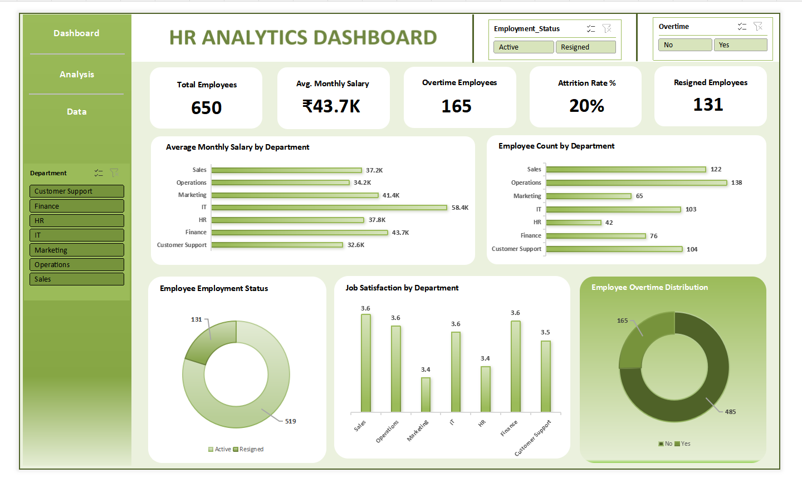

# HR Analytics Dashboard | Excel

## Project Overview
An interactive Excel dashboard designed to analyze workforce performance, employee attrition, compensation, job satisfaction, and overtime.

## Dashboard Preview

## Business Objectives
- Monitor key workforce and attrition metrics.
- Compare employee counts and average monthly salary across departments.
- Explore job satisfaction and overtime patterns.
- Support clear, filterable HR reporting.

## Key Performance Indicators
- **Total Employees:** 650
- **Average Monthly Salary:** ₹43.7K
- **Overtime Employees:** 165
- **Attrition Rate:** 20%
- **Resigned Employees:** 131

*Values reflect the dashboard screenshot and may change when filters are applied.*

## Dashboard Features
- Department-level salary and employee-count charts
- Active versus resigned employee distribution
- Job satisfaction by department
- Employee overtime distribution
- Interactive slicers for employment status, overtime, and department

## Tools & Skills
- Microsoft Excel
- PivotTables and PivotCharts
- KPI cards and interactive slicers
- HR data analysis and reporting
- Dashboard design and data visualization

## Files Included
- `HR-Analytics-Dashboard.xlsx` — Excel workbook containing the dashboard and analysis.
- `hr-dashboard-preview.png` — dashboard screenshot.

## How to Use
1. Download the Excel workbook from this repository.
2. Open it in Microsoft Excel.
3. Use the slicers to filter by employment status, overtime, or department.
4. Clear filters to return to the overall dashboard view.

## Project Purpose
Created as a portfolio project to demonstrate practical Excel skills for entry-level MIS Executive, MIS Analyst, and Data Analyst roles.
